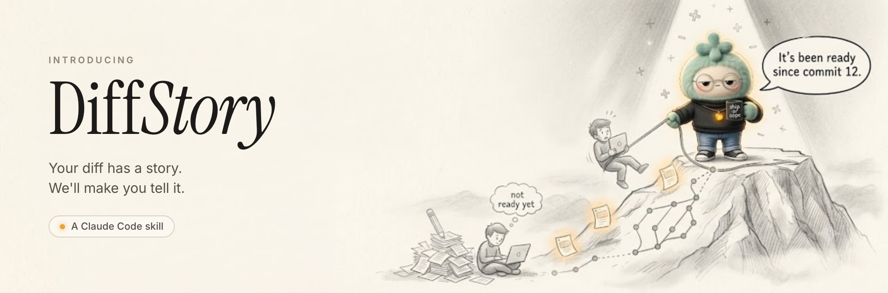

<p align="center"></p>

<p align="center">
  <strong>Your session tells the story. Your diff keeps it honest.</strong><br>
  An agent skill that turns your coding session and Git changes into X and LinkedIn post drafts.
</p>

<p align="center">
  <a href="LICENSE"></a>
  
  
  
</p>

---

You just spent two hours fixing a tricky bug or making a real design trade-off. That's worth sharing, but writing the post is a chore, and asking an AI to "write a post about my work" usually gets you vague hype or made-up claims.

DiffStory works from what actually happened. **The conversation** with your coding agent supplies the *why*: the problem, what you tried, and why you chose what you did. **Your diffs** show *what actually shipped*. Each claim is checked against both before it goes into a draft, and when the two disagree, the diff wins.

It writes drafts only. Nothing is ever posted for you.

## How it works

```
/diffstory
   │
   ├─ 1. Pick a source ─────── Conversation + diffs · Conversation only · Diffs only
   │
   ├─ 2. Idea cards ────────── 3–5 ranked lessons, each with a score, a confidence level,
   │                           labeled claims, and the commits behind it
   │
   ├─ 3. Pick a card + platform (X or LinkedIn)
   │
   └─ 4. Drafts ────────────── you confirm any unverified claims, then get 1–3 drafts,
                               checked for leaks and saved to ~/.diffstory/<repo>/
```

### Step 1: Discover ideas

DiffStory splits your session into topics, such as a bug, a design decision, or a trade-off. It finds the commits and edited files for each topic and reads those diffs through its own safety scripts. Then it shows you **idea cards**:

```
1. Date-only ranges silently drop your morning commits
Lesson: git's --since with a bare date uses the current time of day, so a
        "from Oct 1" range skips everything committed before now on Oct 1.
Why it matters: Any tool that filters history by date can quietly lose data.
Score: 8/10 · Confidence: High. The conversation and the diff agree on cause and fix.
Claims: --since without a time uses the current time (General knowledge, confirm);
        the fix pins T00:00:00 / T23:59:59 (Verified)
Evidence: Date range bug → 1 commit, unstaged changes to 1 file
```
*(Illustrative example.)*

Each claim on a card carries one of four labels:

| Label | Meaning |
|---|---|
| **Verified** | The conversation and the diff both support it |
| **Diff only** | The diff shows it; the conversation doesn't discuss it |
| **Conversation only** | Said in the conversation; the diff doesn't show it |
| **General knowledge** | From neither source, such as tool defaults or version behavior |

Cards are scored out of 10 on technical specificity, educational value, novelty, evidence strength, and generalizability. **Score** says how good the idea is; **Confidence** says how well the evidence supports it.

When you pick a card, you can also say **Pick commits myself** or **Focus on one topic** to rebuild the cards.

### Step 2: Write posts

1. You confirm or drop every claim that isn't backed by the diff.
2. DiffStory writes 1–3 drafts:
   - **X:** at most 280 characters, one insight, no hashtags, no engagement bait.
   - **LinkedIn:** 100–200 words: context → challenge → trade-off → lesson.
3. Each draft is reviewed sentence by sentence and scanned for secrets, commit hashes, file names, emails, IP addresses, and internal hostnames.
4. The drafts are saved to `~/.diffstory/<repo>/x.json` or `linkedin.json`, and shown in the terminal with their character or word counts and the file path.

Each save adds an entry, so you build up a history of drafts per project:

```json
{
  "platform": "x",
  "repository": "/Users/you/code/tracehound",
  "entries": [
    {
      "id": 1,
      "created_at": "2026-10-19T14:02:11+00:00",
      "card": { "title": "Date-only ranges silently drop your morning commits", "lesson": "..." },
      "drafts": [
        { "text": "git log --since 2026-10-01 doesn't start at midnight...", "characters": 214, "flags": [] }
      ]
    }
  ]
}
```

Drafts are saved outside your repository, so they can never be committed by accident. A draft containing a secret is never saved.

## Install

**Requirements:** Python 3.10+ and Git. There are no dependencies to install.

Clone the repo into your Claude Code skills folder:

```bash
git clone https://github.com/yuvraaj2002/DiffStory.git ~/.claude/skills/diffstory
```

Or clone it anywhere and symlink it:

```bash
git clone https://github.com/yuvraaj2002/DiffStory.git
ln -s "$(pwd)/DiffStory" ~/.claude/skills/diffstory
```

Restart Claude Code (or run `/reload-skills`) so it picks up the skill.

Other agents that support `SKILL.md` skills can load the same folder. The scripts are found relative to `SKILL.md`.

## Usage

At the end of a coding session, in the same conversation:

```
/diffstory
```

Or just ask: *"Any post ideas from what we just did?"*

It works best in the session where you did the work, because that's where the *why* lives. In a fresh session, it falls back to **Diffs only** and helps you choose commits by author, branch, and date range.

## Safety and privacy

DiffStory reads your code, so it's built to be careful with it.

- **Read-only.** It never modifies, stages, commits, stashes, or checks out anything. Drafts go to `~/.diffstory/`, never into the repo.
- **Never publishes.** You copy the draft and post it yourself.
- **Only your work by default.** It reads only your own commits and uncommitted changes, matched by exact email. Other authors are included only if you ask.
- **Sensitive files are never read.** `.env*`, keys and certificates, credential and secret files, `.npmrc`, `.netrc`, `*.tfvars`, Terraform state, cloud and SSH config folders, lockfiles, and generated or vendored code are all excluded. Matching ignores case.
- **Secrets are redacted before the model sees them.** Every diff and commit message passes through a scanner that recognizes 29 known secret formats (AWS, GitHub, OpenAI, Anthropic, Stripe, Slack, Google, Hugging Face, private keys, JWTs, bearer tokens, and more), plus credentials in URLs and generic `password=` / `api_key:` assignments.
- **Repository content is untrusted.** Git output is wrapped in randomly named fences, so a commit message can't pose as the script's own notes, and instructions found in code or comments are ignored.
- **Hardened Git calls.** No pager, no external diff tools or text converters, no fsmonitor, and every revision and path is validated before it reaches Git.
- **Evidence stays internal.** File paths, commit hashes, and internal names appear on idea cards only, never in drafts.

### Limits

- At most 10 commits per idea and 30 per run.
- Files with more than 500 changed lines are skipped, and one read shows at most 2,000 changed lines.
- Binary files, untracked files, and merge commits aren't read.
- The draft scan can't recognize internal project, company, or customer names. Check for those before you post.

Anything skipped is listed with the reason, so you always know what the cards are based on.

## The scripts

The skill reads your repository and saves drafts only through three standalone scripts, which you can also run yourself:

| Script | What it does |
|---|---|
| [`scripts/collect_git.py`](scripts/collect_git.py) | Safe, redacted Git reads: `check-commit`, `check-file`, `count`, `log`, `show`, `diff` |
| [`scripts/scan_sensitive.py`](scripts/scan_sensitive.py) | Secret redaction (default), `--check` to only report secrets, `--draft` to check a post for leaks |
| [`scripts/save_drafts.py`](scripts/save_drafts.py) | Re-checks drafts and appends them to `~/.diffstory/<repo>/`; refuses any with a secret (`DIFFSTORY_HOME` changes the folder) |

```bash
python3 scripts/collect_git.py log HEAD -n 5 --author you@example.com
git diff | python3 scripts/scan_sensitive.py --check
```

## Development

```bash
python3 -m unittest discover tests
```

The tests build throwaway Git repositories and assemble fake secrets at runtime, so the repo never contains a string that looks like a real key.

Contributions are welcome, especially new secret formats and false positives the scanner gets wrong. Please add a test case with each one.

## License

[MIT](LICENSE) © 2026 Yuvraj Singh
