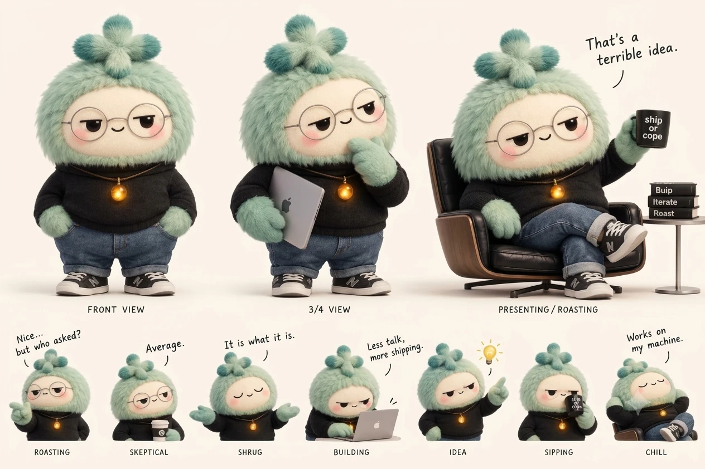

# DiffStory mascot

The reference for every banner, social card and illustration. When generating new art, upload `character-sheet.webp` as the character reference so the mascot stays identical.

## Must stay the same

- Sage-mint fluffy plush body (`#A8D5BA`) with darker teal tips (`#5FA89A`)
- "+" shaped fur tuft on the head
- Pale cream oval face, glossy black bead eyes, rosy cheeks
- Round rimless glasses
- Black mock turtleneck, cuffed blue jeans, black sneakers
- Amber glowing commit-dot pendant (`#E9A23B`)
- Personality: deadpan, half-lidded, sarcastic but never mean

## Scene rules

- Light theme on warm off-white paper (`#F8F4E9`)
- Background and other characters in grey graphite sketch; the mascot is the only fully colored element
- No brand logos in published art (no Apple logo on laptops, no shoe logos). The sheet itself still has them, so remove them from any generated output.

## Type

- Title: Instrument Serif ("Diff" regular, "*Story*" italic)
- Body and labels: Inter
- Speech bubbles: Patrick Hand

See `../banner.html` for the README banner built on these rules.
